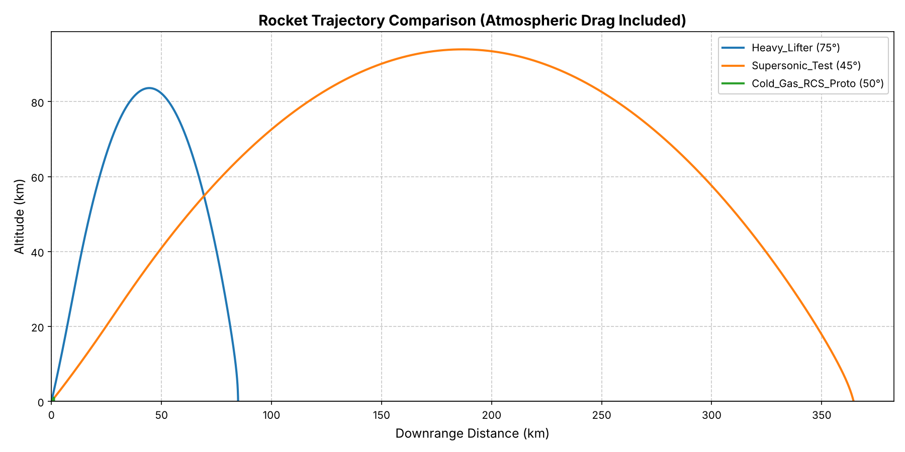
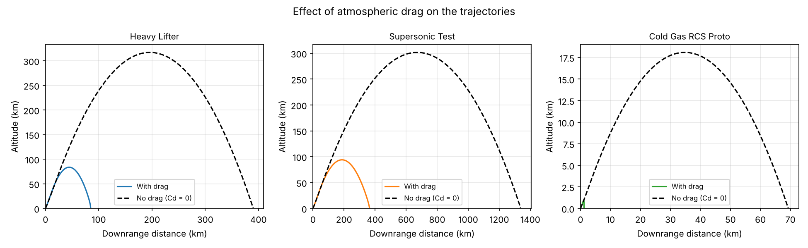

# Rocket Trajectory Calculator

A Python program that simulates the powered and coasting flight of a rocket in two dimensions, with gravity, changing mass and atmospheric drag. Rocket data is read from a CSV file, the equations of motion are integrated with SciPy, and the program prints the apogee, range, flight time, impact speed and impact angle of every rocket and plots their trajectories.

Python Programming course project, B.Tech Aerospace Engineering, SRM Institute of Science and Technology, Kattankulathur (November 2026).

**Team:** Shlok Sangarpal (RA2311019010062), Sahil Bag (RA2311019010064), Prithvi Shankar (RA2311019010090)
**Guide:** Dr. Raghavendra V

---

## Objectives

1. Build a simple two-dimensional model of a powered rocket flight with gravity and atmospheric drag.
2. Implement the model in Python with NumPy, pandas, SciPy and matplotlib, reading the launch data from a CSV file.
3. Simulate three different rockets: a heavy lifter, a supersonic test vehicle and a small cold-gas prototype.
4. Compare the results and find the effect of drag by running the same flights in vacuum.
5. Check the numerical solution against an analytical result.

## Repository contents

```text
├── Proj.py                      # Main program: simulation, printed results and trajectory plot
├── Rocket_Analysis.py           # Extra analysis: drag vs vacuum, solver check, graphs, results table
├── trajectory_parameters.csv    # Input data: one row per launch configuration
├── requirements.txt             # Python libraries needed
├── README.md                    # This file
├── outputs/                     # Program output, graphs and results_summary.csv
└── report/                      # Project report (PDF)
```

## Requirements

- Python 3.8 or newer
- numpy, pandas, scipy, matplotlib

Install the libraries with:

```bash
pip install -r requirements.txt
```

## How to run

1. Download or clone this repository.
2. Open a terminal (Command Prompt on Windows) in the repository folder. Keep `trajectory_parameters.csv` in the same folder as the scripts.
3. Run the main program:

   ```bash
   python Proj.py
   ```

   The results are printed in the terminal and the trajectory graph opens in a window.

4. (Optional) Run the extra analysis:

   ```bash
   python Rocket_Analysis.py
   ```

   This saves `results_summary.csv` and three graphs in the `outputs` folder.

## Input file format

Each row of `trajectory_parameters.csv` is one rocket. To test a new rocket, add a row; no code changes are needed.

| Column | Unit | Meaning |
|---|---|---|
| `Launch_Name` | – | Name of the configuration |
| `M_Initial` | kg | Mass at ignition (propellant + dry mass) |
| `M_Dry` | kg | Mass after all propellant is burnt |
| `Thrust` | N | Constant engine thrust |
| `ISP` | s | Specific impulse |
| `Theta` | deg | Launch angle above the horizontal |
| `Cd` | – | Drag coefficient |
| `Area` | m² | Reference (frontal) area |

## Model

- The rocket is a point mass in a vertical plane (x downrange, z altitude); state = [x, z, vx, vz, m].
- Mass flow rate: ṁ = T / (Isp · g). Thrust acts at the fixed launch angle until the propellant is used up.
- Exponential atmosphere: ρ = ρ₀ · e^(−z/H), with ρ₀ = 1.225 kg/m³ and H = 8,500 m.
- Drag: F_D = ½ ρ v² C_D A, opposite to the velocity.
- Gravity is constant (9.81 m/s²) and the Earth is flat.
- `solve_ivp` (RK45, largest step 0.1 s) integrates the powered flight until a **burnout event** stops it exactly when the propellant runs out, then integrates the coast until a **ground-impact event** stops it at z = 0.

## Results

| Rocket | Launch angle | Apogee (km) | Range (km) | Flight time (s) | Impact speed | Impact angle |
|---|---|---|---|---|---|---|
| Heavy_Lifter | 75° | 83.62 | 84.83 | 340.8 | Mach 0.44 (149.4 m/s) | 88.5° |
| Supersonic_Test | 45° | 93.95 | 364.48 | 324.3 | Mach 0.76 (259.7 m/s) | 67.4° |
| Cold_Gas_RCS_Proto | 50° | 0.97 | 1.18 | 47.7 | Mach 0.10 (32.8 m/s) | 90.0° |

Compared with the same flights in vacuum, drag lowers the apogee by 74 %, 69 % and 95 %. The solver's burnout velocity in vacuum agrees with the analytical rocket-equation value to better than 0.0001 %.





All numbers are in `outputs/results_summary.csv`; the full discussion is in the report in `report/`.

## Limitations

Point mass with a fixed thrust direction (no gravity turn), constant drag coefficient at all Mach numbers, a fixed speed of sound of 343 m/s for Mach numbers, flat non-rotating Earth, constant gravity and no wind. The model is meant for first estimates.
